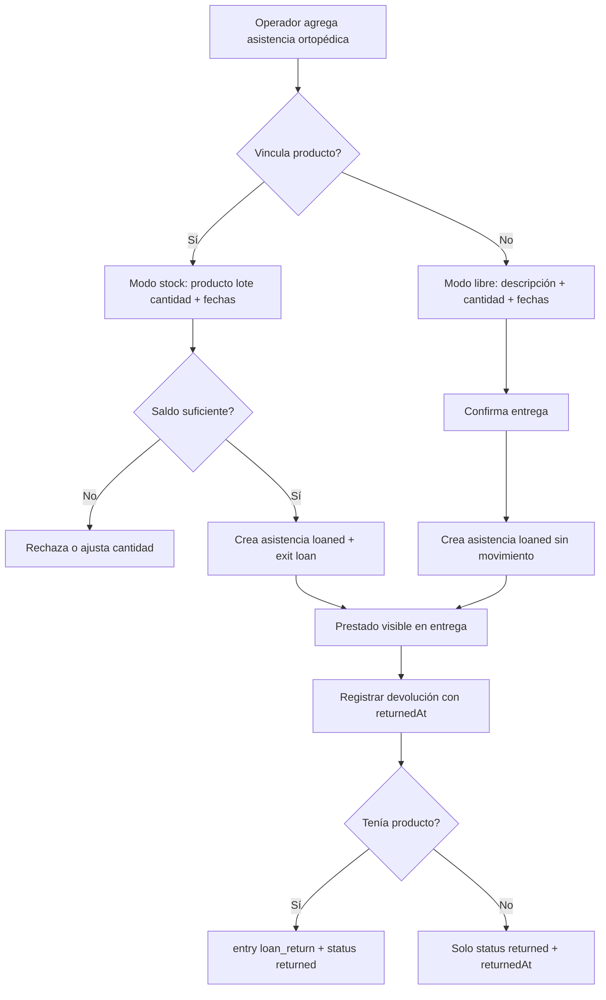

# Plan: Préstamos ortopédicos por stock

## Contexto

Hoy el préstamo ortopédico ya existe como **asistencia de entrega** (`kind: orthopedic` en `delivery-assistances`):

- se carga en la entrega con descripción + cantidad;
- queda `loanStatus: loaned`;
- se puede marcar devolución (`POST .../asistencias/:id/devolver`) y guarda `returnedAt`;
- **no toca productos ni stock**;
- **no tiene fecha de devolución esperada**.

Evidencia: [`src/collections/DeliveryAssistances.ts`](../src/collections/DeliveryAssistances.ts), [`returnOrthopedicAssistance`](../src/deliveries/delivery-service.ts), tests en `tests/int/deliveries.int.spec.ts` (afirman que el saldo no cambia).

El inventario sí tiene saldo por cantidad y movimientos (`entry` / `exit` / `adjustment`), pero los motivos de salida no incluyen préstamo ni devolución ([`src/inventory/types.ts`](../src/inventory/types.ts)).

Quedan carpetas vacías `src/domain/ortopedia/` y `src/collections/ortopedia/` de un intento abandonado de unidades serializadas. **No se retoma ese modelo**: el pedido es préstamo **por stock (cantidad)**.

## Objetivo

Extender el préstamo ortopédico para que:

1. **pueda ser por stock** (producto del depósito + cantidad), sin eliminar el modo libre actual;
2. tenga **fecha de entrega** del préstamo;
3. tenga **fecha de devolución esperada**;
4. al devolver, registre **cuándo se devolvió** y, si fue por stock, **reintegre el saldo**.

## Decisión de diseño

### Un solo dominio: asistencia ortopédica enriquecida

No crear colección/módulo paralelo. Extender `delivery-assistances` + flujo de entrega/devolución existente.

| Modo | Cómo se identifica | Efecto en stock |
|---|---|---|
| Libre (actual) | `product` vacío; descripción + cantidad | Solo estado `loaned` → `returned` |
| Por stock | `product` (y `lot` si el producto controla lote) | Salida al prestar; entrada al devolver |

### Fechas

| Campo | Significado | Obligatorio |
|---|---|---|
| `loanedAt` | Fecha de entrega del préstamo (día operativo) | Sí, para `orthopedic`. Default UI: `deliveryDate` de la entrega |
| `expectedReturnDate` | Fecha de devolución pactada / esperada | Sí, para `orthopedic` |
| `returnedAt` | Momento real de devolución | Solo cuando se registra la devolución |

Reglas:

- `expectedReturnDate >= loanedAt`.
- Al devolver, el operador puede indicar `returnedAt` (fecha/hora o día operativo); si omite, se usa `now`.
- `returnedAt` no puede ser anterior a `loanedAt`.
- Listados futuros pueden marcar “vencido” si `loanStatus === loaned` y `expectedReturnDate < hoy`.

### Stock

Nuevos motivos (no reutilizar `delivery`):

- salida: `loan`
- entrada: `loan_return`

Referencia del movimiento:

- `referenceType: 'delivery-assistance'`
- `referenceId: <assistanceId>`

Al confirmar entrega con ortopédico por stock:

1. validar producto activo y saldo suficiente (misma política: sin saldo negativo);
2. crear asistencia con `loanStatus: loaned`, fechas y vínculo a producto/lote;
3. en la misma transacción Mongo, generar `exit`/`loan` por la cantidad.

Al devolver ortopédico por stock:

1. marcar `loanStatus: returned` + `returnedAt`;
2. generar `entry`/`loan_return` por la misma cantidad (y lote si aplica);
3. idempotencia: segunda devolución = `409`; no duplicar entrada.

Sin producto: comportamiento actual (solo estado + `returnedAt`), más validación de fechas nuevas.

### Anulación de entrega

Si la entrega se anula:

- ortopédico libre abierto: queda bloqueado a devolver (como hoy);
- ortopédico por stock **aún prestado**: compensar la salida `loan` (entrada compensatoria o movimiento de corrección, alineado a `annulDelivery`);
- ortopédico por stock **ya devuelto**: no revertir el `loan_return` automáticamente; la anulación solo compensa líneas de bolsón/productos de la entrega y deja auditoría clara del préstamo histórico.

Documentar esta regla en docs 02/05/09 al implementar.

### Producto

No hace falta flag `isLoanable` en el MVP de esta extensión: cualquier producto activo del catálogo puede prestarse por stock. Opcional posterior: categoría “Ortopedia” o checkbox `loanable` para filtrar el selector.

Lotes: si `tracksLotExpiration`, exigir `lotId` al prestar (igual que entregas sensibles).

### Roles

Sin cambio de permisos en el primer corte: Administración/Admin confirman entregas y registran devoluciones (como hoy). Depósito sigue siendo dueño del saldo; los movimientos quedan visibles en inventario.

Si más adelante Depósito debe devolver sin tocar entregas, se agrega permiso/endpoint dedicado.

## Modelo de datos (delta)

### `delivery-assistances`

Campos nuevos / ajustados para `kind === 'orthopedic'`:

- `product` — relationship opcional → `products`
- `lot` — relationship opcional → `product-lots`
- `loanedAt` — date (día)
- `expectedReturnDate` — date (día)
- `loanStatus` — `loaned` | `returned` (ya existe)
- `returnedAt` — date (ya existe; se puede cargar explícitamente al devolver)

Validación:

- si hay `product` → cantidad obligatoria (ya lo es) y saldo suficiente al confirmar;
- si hay `lot` → debe pertenecer al producto y el producto debe controlar lote;
- sin `product` → no se acepta `lot`;
- `loanedAt` y `expectedReturnDate` obligatorios solo en ortopédico.

### Input API

`DeliveryAssistanceInput` ampliado:

```ts
{
  kind: 'orthopedic'
  description: string
  quantity: number
  productId?: string
  lotId?: string
  loanedAt: string        // YYYY-MM-DD
  expectedReturnDate: string // YYYY-MM-DD
}
```

Devolución:

```ts
POST /api/entregas/:deliveryId/asistencias/:assistanceId/devolver
body?: { returnedAt?: string } // ISO o YYYY-MM-DD
```

### Inventario

- [`src/inventory/types.ts`](../src/inventory/types.ts): agregar `loan` a exit reasons; `loan_return` a entry reasons.
- [`stock-service`](../src/inventory/stock-service.ts): aceptar los nuevos motivos; sin cambiar la invariante de saldo no negativo.
- Labels UI de inventario para mostrar “Préstamo” / “Devolución de préstamo”.

## Flujo



## UI ([`entregas-workspace.tsx`](../src/app/(frontend)/entregas/entregas-workspace.tsx))

Al agregar “Préstamo ortopédico”:

- descripción + cantidad (como hoy);
- selector opcional de producto (y lote si aplica) desde catálogo activo;
- fecha de entrega del préstamo (default = fecha de la entrega);
- fecha de devolución esperada (obligatoria).

En el detalle:

- mostrar modo (libre / stock), producto, fechas, estado;
- si `loaned` y vencido: indicador visual simple;
- botón “Registrar devolución” con campo de fecha real (default hoy).

Inventario: movimientos `loan` / `loan_return` visibles en historial existente; no hace falta pantalla nueva en este corte.

## Docs a actualizar

- [`docs/01-VISION-Y-ALCANCE.md`](../docs/01-VISION-Y-ALCANCE.md) — incluir préstamo ortopédico (libre y por stock).
- [`docs/02-MODELO-DE-DATOS.md`](../docs/02-MODELO-DE-DATOS.md) — campos y motivos de movimiento.
- [`docs/03-MODULOS-FUNCIONALES.md`](../docs/03-MODULOS-FUNCIONALES.md) — función en entregas + impacto en stock.
- [`docs/05-FLUJOS-DE-PROCESOS.md`](../docs/05-FLUJOS-DE-PROCESOS.md) — flujo prestar / devolver.
- [`docs/09-CUESTIONARIO-DEPOSITO.md`](../docs/09-CUESTIONARIO-DEPOSITO.md) — reglas de préstamo/devolución/anulación.
- [`tasks/todo.md`](./todo.md) — tarea verificable nueva (p. ej. **3.4**).

## Tareas de implementación

### 3.4a — Spec y tipos

- Documentar decisión dual (libre vs stock) y fechas.
- Extender `DeliveryAssistanceInput`, colección y `payload-types`.
- Eliminar carpetas vacías `ortopedia` si siguen sin uso.

### 3.4b — Confirmación con stock

- Validar fechas y producto/lote.
- En `confirmDelivery`, si ortopédico con producto: `exit`/`loan` en la misma transacción.
- Persistir `loanedAt`, `expectedReturnDate`, `product`, `lot`.

### 3.4c — Devolución

- Aceptar `returnedAt` opcional.
- Si hay producto: `entry`/`loan_return` idempotente + auditoría.
- Mantener 409 si ya fue devuelto o la entrega está anulada.

### 3.4d — Anulación

- Compensar préstamos por stock abiertos al anular.
- Tests de no doble compensación.

### 3.4e — UI + tests

- Formulario y detalle en entregas.
- Integración: libre sin stock; stock descuenta; devolución repone; fechas obligatorias; vencido solo visual.
- E2E: prestar por producto → devolver → saldo restaurado.
- Actualizar test actual que espera “stock unchanged” para el modo libre; agregar caso stock.

## Criterios de aceptación

1. Ortopédico **sin producto** confirma sin movimiento de stock y exige `loanedAt` + `expectedReturnDate`.
2. Ortopédico **con producto** descuenta exactamente la cantidad al confirmar (`reason: loan`).
3. Devolución de préstamo por stock repone la misma cantidad (`reason: loan_return`) y guarda `returnedAt`.
4. Segunda devolución falla; saldo no se duplica.
5. Sin saldo suficiente no se confirma el préstamo por stock.
6. UI muestra fechas de entrega, devolución esperada y devolución real.
7. Docs y `tasks/todo.md` reflejan el comportamiento.

## Fuera de alcance (este plan)

- Unidades serializadas / número de inventario individual.
- Reservas previas al préstamo.
- Multidepósito.
- Penalidades, depósitos en garantía o estado del ítem (roto/perdido) más allá de una observación al devolver.
- Pantalla dedicada de “préstamos vencidos” (solo indicador en detalle; reporte puede ir con 3.2).

## Orden sugerido

Después de estabilizar entregas (3.1 ya hecho). Puede ir **en paralelo o justo antes/después de reportes (3.2)**; conviene antes de cerrar el piloto si Depósito opera ortopedia desde el mismo depósito central.

Dependencias: inventario (2.x) + entregas (3.1). Idealmente anulación (3.3) lista o se implementa la compensación de préstamos junto con 3.4d.
